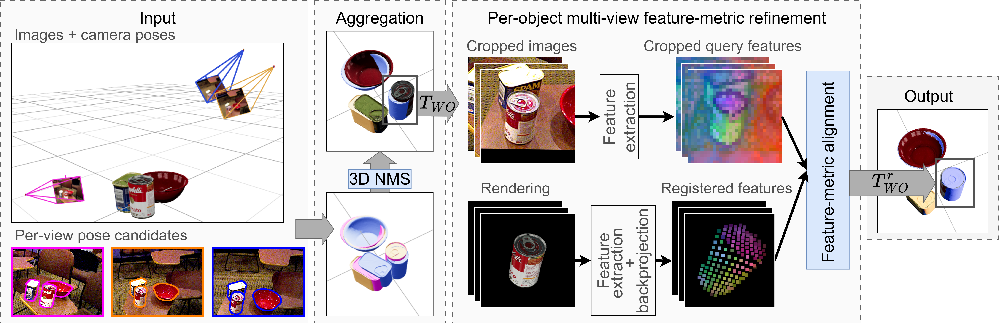

<p align="center">
  <h1 align="center">AlignPose: Generalizable 6D Pose Estimation via <br> Multi-view Feature-metric Alignment</h1>
  <p align="center">
    <a href="">Anna Šárová Mikeštíková</a>
    ·
    <a href="https://medericfourmy.github.io">Médéric Fourmy</a>
    ·
    <a href="https://cifkam.github.io">Martin Cífka</a>
    ·
    <a href="http://people.ciirc.cvut.cz/~sivic/">Josef Sivic</a>
    .
    <a href="https://petrikvladimir.github.io">Vladimir Petrik</a>
  </p>
  <h3 align="center">
    <a href="https://arxiv.org/abs/2512.20538" align="center">Arxiv</a>
    ·
    <a href="https://mikestikova.github.io/alignpose/" align="center">Project Page</a>
  </h3>
</p>

<p align="center">
  
</p>

This repository contains code for AlignPose, our method for 6 object pose estimation from multiple views. It provides a pipeline to run multi-view featuremetric refinement for [BOP](https://bop.felk.cvut.cz/) datasets.

## Table of Contents

- [Environment setup](#setup)
- [Running Alignpose for BOP](#alignpose_bop)
   - [Dataset](#dataset)
   - [Generate templates](#templates)
   - [Generate representations](#representations)
   - [Single view poses](#single_view_poses)
   - [Multi view refinement](#multi_view_poses)
   - [BOP evaluation](#bop-evaluation)
- [Running Alignpose for custom objects](#alignpose_custom)
- [Acknowledgements](#acknowledgements)
- [License](#license)

## Environment setup <a name="setup"></a>

Download the code with the git submodules and navigate to the folder:

```bash
git clone --recurse-submodules https://github.com/mikestikova/alignpose_project.git
cd alignpose_project
```

Setup the [conda](https://docs.conda.io/projects/conda/en/latest/user-guide/getting-started.html) environment for CUDA:
```bash
conda env create -f conda_alignpose_gpu.yaml
```

Next, create (or update) the conda environment activation script to set the necessary environment variables. This script will run automatically when you activate the environment.

The activation script is typically located at ```$CONDA_PREFIX/etc/conda/activate.d/env_vars.sh```. You can find ```$CONDA_PREFIX``` by running:
```bash
conda info --envs
```
If the ```env_vars.sh``` file does not exist, create it. 

Edit the ```env_vars.sh``` file as follows:

```bash
#!/bin/sh

export ALIGNPOSE=/path/to/alignpose/repository  # Replace with the path to the AlignPose repository.
export BOP_PATH=/path/to/bop/datasets  # Replace with the path to BOP datasets (https://bop.felk.cvut.cz/datasets).

export PYTHONPATH=$ALIGNPOSE:$ALIGNPOSE/src/external/bop_toolkit:$ALIGNPOSE/src/external/dinov2:$ALIGNPOSE/src/external/pixloc
```

Activate the conda environment:
```bash
conda activate alignpose_gpu
```

## Reproducing Alignpose for BOP datasets<a name="alignpose_bop"></a>
Currently we support BOP datasets from BOP-Industrial track (ITODD-MV, XYZ-IBD, IPD) and selected datasets from BOP-Classic track (YCB-V, T-LESS).

### Dataset <a name="dataset"></a>
Download the BOP datasets from [here](https://bop.felk.cvut.cz/datasets/). 
Note that we only need the `base` archive with the dataset info, `models` folder and `test` folder. Extract dataset to this [format.](https://github.com/thodan/bop_toolkit/blob/master/docs/bop_datasets_format.md)

In addition to the test images, this method needs a specification of which views shoud be used together in the multi-view setup:
- BOP Industrial (IPD, XYZIBD, ITODDMV) contain `test_targets_multiview_bop25.json` file.
- BOP Classic Core (YCBV, TLESS) do not contain this file so we provide it in `data/bop_test_targets/{dataset}/test_targets_multiview_bop25.json`. These files were generated for 4-view setup.  

#### Fixing YCB-V camera poses
The camera poses (`cam_R_w2c`, `cam_t_w2c`) in the YCB-V test split are not consistent with the ground-truth object poses: although the objects are static, their poses expressed in the world frame drift over time. Since multi-view refinement relies on the relative camera poses, these need to be fixed before running AlignPose on YCB-V.

Recompute the camera poses by assuming the objects are static (object world poses are taken from the first frame of each scene). The fixed `scene_camera.json` files are saved to `data/ycbv/fixed_drift/{scene_id}/`; the original dataset is not modified:
```bash
python src/scripts/fix_ycbv_drift.py --bop-test-dir $BOP_PATH/ycbv/test --out-dir data/ycbv/fixed_drift
```

Then replace the original camera files in the dataset with the fixed ones (the originals are kept as `scene_camera_orig.json`):
```bash
for d in data/ycbv/fixed_drift/*/; do
    scene=$(basename $d)
    cp $BOP_PATH/ycbv/test/$scene/scene_camera.json $BOP_PATH/ycbv/test/$scene/scene_camera_orig.json
    cp $d/scene_camera.json $BOP_PATH/ycbv/test/$scene/scene_camera.json
done
```

### Generate templates <a name="templates"></a>
Specify your configs in `src/configs/gen_templates/ycbv.json` and run the template generation:
```bash
python src/scripts/gen_templates.py --opts-path src/configs/gen_templates/ycbv.json
```

### Generate object representation <a name="representations"></a>
Specify your configs in  `src/configs/gen_repre/ycbv.json` and generate PCA per-object representation:
```bash
python src/scripts/gen_repre.py --opts-path src/configs/gen_repre/ycbv.json
```

### Prepare input pose estimates <a name="single_view_poses"></a>
Because this is a refinemet method, we need some coarse input poses that will be refined. We provide sample input poses in the `data/inputs` folder. Alternatively, you may download input poses `.csv` files from [BOP Leaderboard](https://bop.felk.cvut.cz/leaderboards/pose-estimation-unseen-bop23/ycb-v/) or generate them with any single-view pose estimation method.

Format of input:
- BOP Classic Core (YCB-V, T-LESS): One `.csv` file with predictions in BOP format.
- BOP Industrial (IPD, XYZIBD, ITODDMV): Folder containing a `.csv` files with predictions for all of the cameras named `{camera_id}-xxxx_{dataset-name}-test.csv`.


### Run multi-view refinement <a name="multi_view_poses"></a>
Run multi-view refinement using the following script and configuration. The output will be one `.csv` file in BOP format for each camera. 
`configs/refine/ycbv.json`
```bash
python src/scripts/refine_multiview.py --opts-path src/configs/refine_multiview/ycbv.json
```


### BOP Evaluation <a name="bop-evaluation"></a>
Evaluate the BOP submission file by running this script.
```
python src/scripts/results_evaluate_bop.py --csv_path  path/to/csv/results.csv
```


## Running Alignpose for custom objects <a name="alignpose_custom"></a>
This section describes how to run AlignPose on your own objects, without depending on BOP datasets.

### Preprocess objects
Each object needs a preprocessed representation. Object IDs must be unique.
```bash
python src/scripts/preprocess_objects.py \
    --model-paths path/to/models/obj_000001.ply path/to/models/obj_000002.ply \
    --object-ids 1 2 \
    --output-dir object_repre/custom_dataset/repre_v1
```
Each representation is saved to `<output-dir>/<object-id>/repre.pth`. To use the representations in `refine_multiview.py`, save them to `object_repre/<object_dataset>/<repre_version>` and set `repre_version` in the refinement config to match.

You can do the same from Python:
```python
from src.utils_multiview.processing.object_pca import fit_object_pca, save_object_pca

repre = fit_object_pca("path/to/my_object.ply")
save_object_pca(repre, "object_repre/custom_dataset/repre_v1", object_id=1)
```

### Run multi-view refinement
Comming soon!


## Citation
If you find this code useful in your research, please cite:

```
@InProceedings{mikestikova2026alignpose,
    author    = {Mike\v{s}t{\'\i}kov\'a, Anna \v{S}\'arov\'a and Fourmy, M\'ed\'eric and Cifka, Martin and Sivic, Josef and Petrik, Vladimir},
    title     = {AlignPose: Generalizable 6D Pose Estimation via Multi-view Feature-metric Alignment},
    booktitle = {Proceedings of the IEEE/CVF Conference on Computer Vision and Pattern Recognition (CVPR)},
    month     = {June},
    year      = {2026}
}
```

## Acknowledgements <a name="acknowledgements"></a>

This repository relies heavily on the following works:
- [BOP Toolkit](https://github.com/thodan/bop_toolkit) -  Evaluation scripts, standard utils
- [FoundPose](https://github.com/facebookresearch/foundpose) - Single-view pose estimation, utils
- [Pixloc](https://github.com/cvg/pixloc) - Featuremetric refinement

## License <a name="license"></a>

The code in this repository is released under the [MIT License](LICENSE), with the following exceptions:
- `foundpose/` and the files adapted from [FoundPose](https://github.com/facebookresearch/foundpose) (`src/scripts/gen_repre.py`, `src/scripts/gen_templates.py`, `src/utils_multiview/opts.py`) are licensed under [CC BY-NC 4.0](foundpose/LICENSE).
- The submodules in `src/external/` ([BOP Toolkit](https://github.com/thodan/bop_toolkit), [DINOv2](https://github.com/facebookresearch/dinov2), [Pixloc](https://github.com/cvg/pixloc)) are distributed under their own licenses.

Note that the full pipeline depends on the FoundPose code, so running it is subject to the non-commercial terms of CC BY-NC 4.0.
